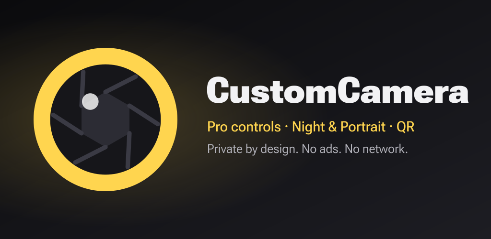

# CustomCamera

A fast, private Android camera with real manual controls. Built on CameraX 1.6
with Camera2 interop, Material 3 and Kotlin. No ads, no accounts, and no
network access (the `INTERNET` permission is removed from the merged manifest).

<p align="center"></p>

## Features

| Area | What you get |
| --- | --- |
| **Modes** | Photo, Video, Pro, QR Scan — plus Night and Portrait (CameraX Extensions) and **Dual** (front + back picture-in-picture video) when the device supports them. Optional modes are discovered in the background and only shown if available. |
| **Dual video** | Both cameras record at once through CameraX concurrent cameras; CameraX composites the inset into the recording itself (not a screenshot). Tap the inset to move it to another corner; the flip button swaps which camera fills the frame. |
| **Pro mode** | Manual ISO, shutter speed, white balance and focus distance applied through `Camera2CameraControl`, with live auto readings from the capture results. **Focus peaking** highlights sharp edges while focusing manually. Values are remembered between sessions. RAW (DNG) + JPEG when supported. |
| **Photo** | Hold the shutter for a **burst** (up to 30), flash off/auto/on, front **screen flash**, HDR extension toggle, Ultra HDR (JPEG_R), 3:4 / 9:16 / 1:1 via a CameraX `ViewPort` so the preview matches the file, capture priority (quality / latency / zero shutter lag), JPEG quality, mirrored selfies, optional geotagging. |
| **Video** | 4K / 1080p / 720p / 480p with automatic fallback, stabilization, 10-bit HLG HDR, pause / resume, photos while recording, torch with adjustable brightness (Android 15+ hardware), and **camera switching while recording** (persistent recordings). |
| **Viewfinder** | Tap to focus with exposure slider, long-press AE/AF lock, pinch and preset zoom chips (0.6× … 5×), swipe to change mode or flip camera, self-timer, grids (thirds / golden / square), level indicator, live histogram with clipping warnings, volume-key shutter or zoom, haptics. On phones the preview stays portrait and icons rotate with the device. |
| **Tablets & foldables** | Large screens rotate freely: a landscape window moves the shutter, flip and gallery buttons to a rail on the side, centres a landscape preview beside it and crops captures to match (4:3 / 16:9 / 1:1). Pro and scan panels stay a readable width. The crop editor puts its tools in a side column in landscape. |
| **Cameras** | Lens picker listing every camera Camera2 exposes (with 35 mm-equivalent focal length); if a camera fails to bind, the app falls back to the next working one automatically. |
| **Scanner** | On-device QR / barcode scanning (ZXing: QR, Data Matrix, Aztec, PDF417, EAN/UPC, Code 128/39/93, Codabar, ITF) with boxes mapped onto the preview; one-tap actions for links, Wi-Fi (system "add network" sheet), phone, SMS, email and geo codes. |
| **Gallery** | Grid of your captures and a swipeable viewer with pinch / double-tap zoom, video playback, share, edit, EXIF details and delete. A built-in **Crop & rotate** editor (free or fixed aspect, 90° rotation, mirror) saves a new `_edit` copy with the original EXIF and never changes the original. Captures are saved to `DCIM/CustomCamera` via MediaStore. |
| **System integration** | Handles `IMAGE_CAPTURE` (with review), `VIDEO_CAPTURE`, `STILL_IMAGE_CAMERA(_SECURE)` and `VIDEO_CAMERA`; launcher shortcuts for Selfie, Video and Scan; splash screen; adaptive + themed icon. |

## Architecture

```
app/src/main/java/com/customcamera/app/
├── core/            Pure Kotlin, unit-tested: options, exposure / zoom / lens /
│                    orientation / crop math, histogram, barcode content parsing, naming
├── camera/          CameraController (CameraX session owner) + state / event models
├── ui/              CameraActivity, Pro panel binder, custom views (shutter, grid,
│                    level, focus ring, histogram, barcode overlay, EV slider)
├── gallery/         MediaStore repository + helpers, GalleryActivity, MediaViewerActivity,
│                    PhotoEditorActivity + CropOverlayView (crop & rotate copies)
├── settings/        AppSettings (typed prefs) + SettingsActivity / fragment
├── scan/            Scan result presentation and actions
└── util/            Coroutine/future bridge, EXIF-aware decoding, feedback, location, shortcuts
```

`CameraController` exposes a `StateFlow<CameraState>` and a `SharedFlow<CameraEvent>`;
the activity renders state and reacts to events. Use cases are composed per mode
(Preview + ImageCapture [+ histogram analysis], Preview + VideoCapture, or
Preview + barcode analysis) to stay within guaranteed stream combinations.

## Building

Requirements: JDK 17+, Android SDK with platform 36.

```bash
./gradlew :app:assembleDebug            # debug APK (applicationId tribixbite.customcamera.debug)
./gradlew :app:testDebugUnitTest        # JVM unit tests (core/)
./gradlew :app:lintDebug
./gradlew :app:assembleStaging          # R8-shrunk build, installable beside a release
./gradlew :app:assembleRelease          # release APK: signed with keystore.properties, else unsigned
```

On-device tests (35 instrumented tests; they delete every capture they make):

```bash
./gradlew :app:assembleDebug :app:assembleDebugAndroidTest
adb install -r app/build/outputs/apk/debug/app-debug.apk
adb install -r -t app/build/outputs/apk/androidTest/debug/app-debug-androidTest.apk
adb shell am instrument -w tribixbite.customcamera.debug.test/androidx.test.runner.AndroidJUnitRunner
```

**Termux / ARM64 hosts:** AGP's Maven aapt2 is x86_64; set
`android.aapt2FromMavenOverride` to a native aapt2 (this repo relies on the
device-wide `~/.gradle/gradle.properties`). `scripts/gradle-locked.sh` wraps
`./gradlew` with the shared build lock used on the development device.

## Releasing

Signed APKs are published on [GitHub Releases](https://github.com/tribixbite/CustomCamera/releases)
and are built to be reproducible for F-Droid. See [RELEASING.md](RELEASING.md) for the signing
key, tagging, developer verification and F-Droid ([fdroid/README.md](fdroid/README.md)).
Privacy policy: [PRIVACY.md](PRIVACY.md).

## License

MIT — see [LICENSE](LICENSE).
